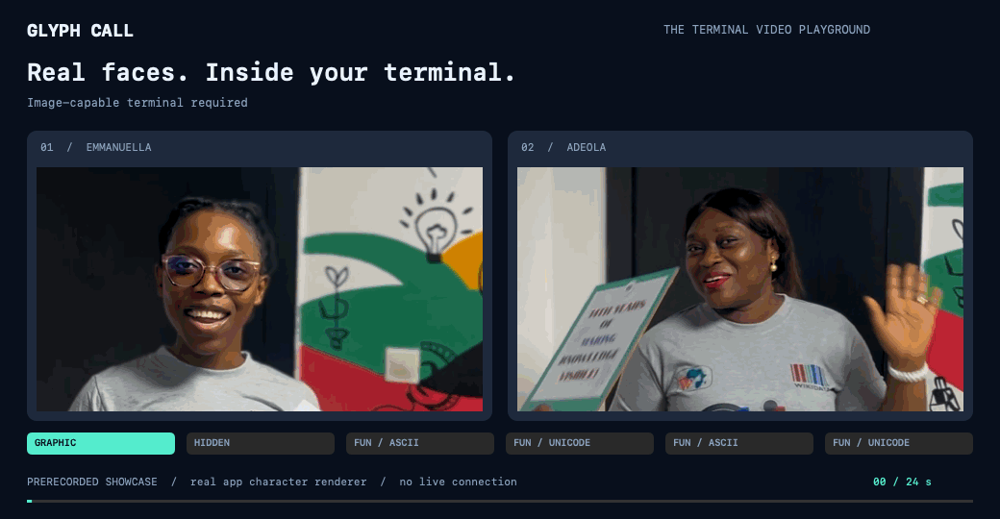
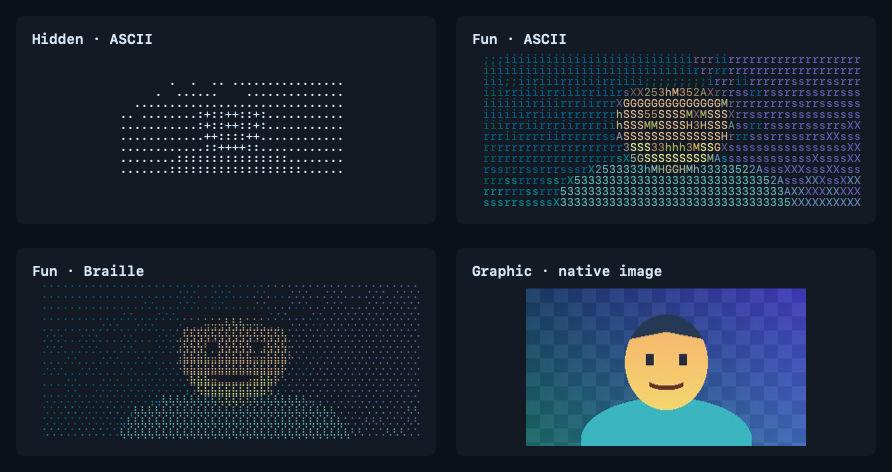
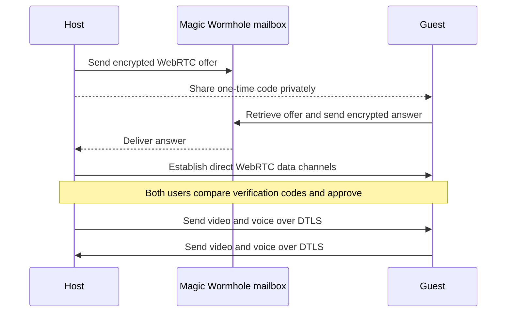

# Glyph Call

Peer-to-peer video and voice calls from the terminal. Video can appear as ASCII, colored Unicode art, or a native terminal image.



*Prerecorded demo with two real participants. The Graphic segment places cropped video frames into the layout. The Fun segment uses the app’s Braille renderer with brighter midtones.*

The demo GIF is licensed under [CC BY-SA 4.0](https://creativecommons.org/licenses/by-sa/4.0/). It combines cropped, shortened and recolored excerpts from [Emmanuella Oluwapelumia Aina’s clip](https://commons.wikimedia.org/wiki/File:Video-output-0BDB93DD-E9BC-41A8-8839-004A1CF0CB50-1.webm) by Aminw 21 and [Adeola Alabi’s clip](https://commons.wikimedia.org/wiki/File:Video-output-2DBE5F83-C0E9-4298-8D7F-5FBB8D8230BD-3.webm) by Aminwa 21, both from Wikimedia Commons.

## Get started

Install Go 1.26 or newer. Camera and microphone capture require macOS 14 or newer and Apple's Command Line Tools (`xcode-select --install`).

```sh
git clone https://github.com/amirhdolati/glyph-call.git
cd glyph-call
./build.sh
./bin/glyph-call
```

Choose **Host a call** to generate an invite code. Share it privately and have the other person choose **Join a call**. Compare the displayed verification codes through a trusted channel, then both type `yes` to start. Press **Ctrl+C** to hang up. If macOS asks, grant the app access to the devices you intend to use.

```sh
# Preview with a generated image and no camera or microphone.
./bin/glyph-call preview --synthetic --mode fun

# Start a call with Unicode art and natural voice.
./bin/glyph-call host --mode fun --voice real

# Enter the invite code at the prompt.
./bin/glyph-call connect
```

[راهنمای فارسی](docs/quickstart-fa.md) · [Contributing](CONTRIBUTING.md) · [Support](#support)

## Video and audio

| Mode | What you see |
| --- | --- |
| **Hidden** | Coarse grayscale ASCII, capped at 32 × 16 cells. |
| **Fun** | Colored Braille by default. Use `--fun-style ascii` for colored ASCII. |
| **Graphic** | Camera images in compatible terminals such as Kitty and iTerm2. Each receiver falls back to character art if image support is unavailable. |



Use `--voice real`, `robot`, `8bit`, `radio`, or `off`. The host requests a voice mode and quality, and the peers negotiate what they support. Use `--no-camera` or `--no-audio` to disable a local device. Run `./bin/glyph-call host --help` for all flags.

The Go CLI and synthetic preview also work on Linux. Native camera and microphone capture are implemented for macOS.

## How a call connects



The mailbox handles setup. Audio and video travel directly between peers. Public STUN helps peers discover addresses. Calls can fail behind networks that need a TURN relay. Use `--no-stun` to skip public STUN or `offer` and `join` to exchange setup files manually.

Hidden mode reduces visual detail. People or surroundings may still be recognizable from the image and audio.

## Development

```sh
go test -race ./...
go vet ./...
```

| Path | Responsibility |
| --- | --- |
| `cmd/glyph-call` | CLI entry point |
| `cmd/package` | ZIP packaging |
| `internal/app`, `internal/session` | Call flow and capability negotiation |
| `internal/connection`, `internal/signaling` | WebRTC and invite exchange |
| `internal/media`, `internal/terminal`, `internal/devices` | Media encoding, terminal output, and native capture |

Build a universal macOS binary with `./build.sh --universal`, then run `go run ./cmd/package` to generate ZIPs under `dist/`.

## Support

Support development on the **TRON** network using the same donation address and QR code published by [GlyphForge Engine](https://github.com/amirhdolati/glyphforge-engine#support).

`TZ6HTiRLeyWoFJ5rGgx6qbMyjLAHNb6hfb`

[View the donation address on TRONSCAN](https://tronscan.org/#/address/TZ6HTiRLeyWoFJ5rGgx6qbMyjLAHNb6hfb)

<a href="https://tronscan.org/#/address/TZ6HTiRLeyWoFJ5rGgx6qbMyjLAHNb6hfb"></a>
